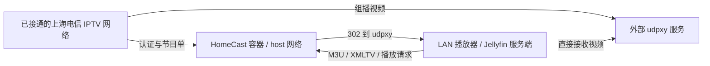

# HomeCast · 上海电信 IPTV

家庭局域网内的上海电信 IPTV 频道与节目单服务：中文频道列表、当前/下一节目、按天节目单、定时更新，以及供 Apple TV、Jellyfin 等客户端订阅的 M3U / XMLTV。视频由独立部署的 udpxy 转发。

**仅验证上海电信，不面向其他省份、运营商或任意机顶盒协议。** 使用自己的已开通业务和机顶盒身份；本项目非电信官方产品，不提供账号、节目源、DRM 解密、录制或转码，也不是 Docker 管理面板。

## 部署前置条件

先确认以下条件，再执行安装命令。HomeCast 不会替你开通 IPTV 或配置家庭网络。

| 必须具备 | 如何确认 |
| --- | --- |
| 已开通的上海电信 IPTV 线路 | 自己的机顶盒在计划使用的链路上正常播放 |
| 自己机顶盒的协议身份 | 已取得 UserID、协议 SN、MAC，见 [账号发现](docs/account-discovery.md) |
| Linux amd64 软路由和 IPTV 接口 | 推荐并已验证 x86 Linux 软路由；接口有 IPTV IPv4，能访问运营商认证/节目单服务 |
| 可用的组播链路与路由 | udpxy 能从指定 IPTV 接口接收频道，不只是普通互联网可达，见 [网络条件](docs/network.md) |
| 独立运行的 udpxy | 已完成 [udpxy 设置与检查](docs/udpxy.md)，LAN HTTP 端口可访问 |
| Docker Engine 与 Compose 插件 | Linux 部署主机能运行 `docker compose version`，支持 host 网络 |
| 可信 LAN 内的客户端 | 播放器或 Jellyfin 服务端能直接访问 HomeCast 和 udpxy；不对公网开放 |

**只有互联网接入的普通 NAS、PC、VPS 不能使用。** 其他具备同等 IPTV 网络条件的 Linux 主机理论上可行，但未验证。macOS / Windows 可用于编辑文件；Docker Desktop 的虚拟网络不能替代上述 IPTV 接口。

## 工作方式

HomeCast 通过 IPTV 接口认证并更新频道/EPG，缓存保存在 `/data`。播放器从 HomeCast 获取订阅；播放时收到 HTTP 302，再直接连接 udpxy 接收视频。两项服务独立部署、独立维护。



> **不知道 IPTV 账号？先完成[账号获取教程](docs/account-discovery.md)，再填写 Compose。**

## 快速开始

默认使用预构建镜像 `ghcr.io/holyful/shanghai-telecom-iptv:0.2.0`，**不在安装时构建源码**。版本与变更记录见 [项目发布页](https://github.com/holyful/shanghai-telecom-iptv/releases)。

1. 将对应版本的 [compose.yaml](compose.yaml) 放入 Linux 部署主机上的私有目录。使用预构建镜像不需要完整源码。
2. 编辑其中的 `environment`：填入自己的三项身份，替换示例 LAN 地址、允许网段及 IPTV 接口。`192.0.2.1` / `192.0.2.0/24` 仅供文档展示，必须换成实际部署值。
3. 明确填写下面三个地址，然后启动。

| 配置 | 填什么 | 示例，仅供替换 |
| --- | --- | --- |
| `HOMECAST_BIND_ADDRESS` | 本机监听的 LAN IPv4，不带协议或端口 | `192.0.2.1` |
| `HOMECAST_PUBLIC_URL` | 客户端使用的 HomeCast 统一地址，含协议和端口；PUBLIC 不表示公网 | `http://192.0.2.1:34400` |
| `HOMECAST_UDPXY_URL` | 独立 udpxy 的 HTTP 地址，播放客户端必须能直接访问 | `http://192.0.2.1:4022` |

在该目录执行：

```bash
chmod 600 compose.yaml
docker compose config --quiet
docker compose pull homecast
docker compose up -d --no-build homecast
```

只有一个命名数据卷挂载到 `/data`；不挂载 Docker socket，不启动 udpxy，不需要额外配置文件。`config --quiet` 只检查 Compose 格式，不验证身份、网络或镜像是否已发布。变量说明与跨平台编辑方式见 [配置指南](docs/configuration.md)。

## 验证与订阅

```bash
docker compose ps
docker compose logs --tail 50 homecast
```

打开自己设置的 `HOMECAST_PUBLIC_URL`。默认首次启动会自动更新；无有效缓存时订阅返回 503，成功后页面应显示真实频道、节目单和最近成功时间。`/health` 与容器健康状态不代表视频已经可播，还需完成 [限时播放检查](docs/udpxy.md#限时播放检查)。

页面“订阅链接”使用配置的 `HOMECAST_PUBLIC_URL`，不会随浏览器访问别名改变。M3U 和 XMLTV 通常需要分别填写，见 [播放器接入指南](docs/clients.md)。

| 用途 | 追加到 `HOMECAST_PUBLIC_URL` 的路径 |
| --- | --- |
| Apple TV / 通用 M3U | `/m3u/xteve.m3u` |
| 通用 XMLTV | `/xmltv/xteve.xml`，压缩版 `/xmltv/xteve.xml.gz` |
| Jellyfin 专用 M3U | `/m3u/jellyfin.m3u` |
| Jellyfin 配套 XMLTV | `/xmltv/jellyfin.xml` |

默认每天上海时间 05:00 自动更新，页面可修改。显式设置调度环境变量后，对应字段由部署配置管理并在页面锁定，详见 [调度设置](docs/configuration.md#调度设置)。


## 进一步配置

| 文档 | 内容 |
| --- | --- |
| [网络条件](docs/network.md) | IPTV 接口、组播、主机选择与客户端可达性 |
| [账号发现](docs/account-discovery.md) | 从自己的已授权设备取得协议身份 |
| [外部 udpxy](docs/udpxy.md) | 初次配置、只读诊断与限时播放检查 |
| [配置与维护](docs/configuration.md) | 环境变量、调度、数据备份与升级 |
| [播放器接入](docs/clients.md) | Apple TV、Jellyfin、Kodi、VLC |
| [开发与源码构建](docs/development.md) | 可选构建 override、测试与交付参考 |

## 安全与许可

这是无登录的可信 LAN 工具。允许网段内的用户可以查看频道、触发更新和修改未锁定的调度；IP/Host 检查不是身份认证。**不要公网映射 HomeCast 或 udpxy，不要接入公开反向代理。** 填写后的 Compose 含未加密的机顶盒身份，Docker 管理员也能查看容器环境变量。不要提交或公开该文件、缓存、订阅地址和抓包，详见 [安全说明](SECURITY.md)。

MIT 许可。Lucide 图标及许可证随包保留。协议调查参考 [pcg-iptv](https://github.com/pcg562240/pcg-iptv) 的公开资料，未打包或复制其实现。
