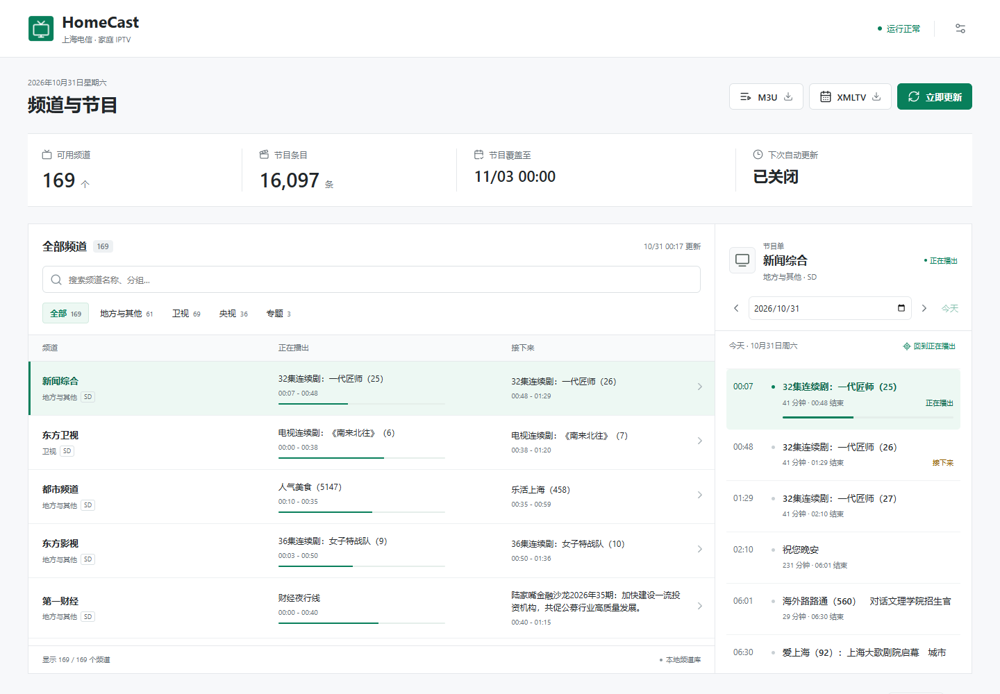
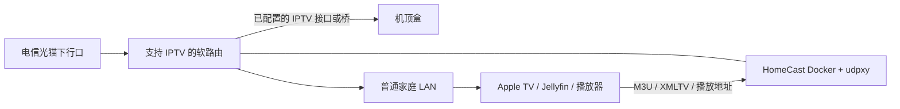

# HomeCast · 上海电信 IPTV

面向家庭局域网的上海电信 IPTV 频道与节目单服务。使用自己的已开通账号，从运营商接口获取频道和 EPG，生成 M3U / XMLTV，并通过已有的 udpxy 播放组播频道。

**仅验证上海电信；不支持其他省份、运营商或任意机顶盒协议。** 本项目非电信官方产品，不提供账号、节目源、订阅资格、DRM 解密或网络开通服务。频道权限及接口可用性取决于自己的订阅和当地网络。

## 它做什么

- 中文管理页面：频道搜索、分组、当前/下一节目、按天节目单、更新进度和日志。
- 内置每日定时刷新，可在页面修改时间；不需要额外 crontab。
- 每次刷新重新认证并读取 IPTV 网卡的当前 IP，不依赖抓包中的临时 token。
- 原子替换频道与节目单；失败时继续使用上次有效缓存。
- M3U / XMLTV 与 xTeVe 常用路径兼容，播放请求重定向到 udpxy。
- 账号、网卡、内网地址全部通过本地配置传入，不打包到镜像。

不是完整 xTeVe、DVR 或转码服务器：没有 SSDP 自动发现、录制、时移、DRM、转码和通用多来源映射。支持通过明确 URL 接入 IPTV 播放器 / Jellyfin。客户端需要能访问 udpxy。



## 先检查网络

必须已经开通上海电信 IPTV，且自己的机顶盒正常播放。部署主机需要有能访问运营商 IPTV 网络的 IPv4 接口，udpxy 也需能接收该网络组播。普通互联网出口不能代替 IPTV 接口。



这不是要求机顶盒必须直插光猫。只要中间的 VLAN、桥接、DHCP 和组播链路正确，机顶盒可以接在路由器或交换机后。部分光猫所有下行口都带 IPTV，部分只绑定特定端口，必须以自己的配置为准。

普通交换机可以延长已经可用的 IPTV 链路。只有需要拆分 VLAN、修改 tag/untag/PVID 时才需要支持 VLAN 的设备；软路由能直接处理时，不必额外买管理型交换机。详见 [网络拓扑](docs/network.md)。

## 第一次安装

当前发布镜像为 **Linux amd64**，已在 x86 软路由验证。Docker Desktop 的 macOS / Windows 虚拟网络不能直接替代路由器上的 IPTV 接口；可以在这些系统编辑配置，再部署到 Linux。其他架构需自行构建验证。

1. 取得自己的 `user_id`、`protocol_sn`、`mac`。不知道账号很正常，先看 [账号发现与一次性抓包](docs/account-discovery.md)。
2. 将 `config.example.json` 复制为 `config.json`，替换所有 `CHANGE_ME` 和文档示例地址 `192.0.2.x`。
3. 确认 `interface` 指向 IPTV 接口，而 `bind_address` 指向家庭 LAN 地址，两者不是同一个概念。

Linux / macOS 编辑端：

```bash
cp config.example.json config.json
chmod 600 config.json
mkdir -p data
```

Windows PowerShell 编辑端：

```powershell
Copy-Item config.example.json config.json
New-Item -ItemType Directory -Force data
```

在接通 IPTV 的 Linux 部署主机上：

```bash
docker compose pull
docker compose up -d
docker compose logs --tail 50
```

打开 `http://你的路由器LAN地址:34400/`。首次启动自动拉取，抓取期间尚无缓存时订阅端点返回 503。之后播放器读取缓存，不会每次看电视都重新认证。

| 配置 | 含义 |
| --- | --- |
| `user_id` | IPTV 协议中的 UserID，不一定是宽带账号 |
| `protocol_sn` | 协议登录里的 SN，不一定等于机身贴纸 S/N |
| `mac` | 自己机顶盒的协议 MAC |
| `interface` | Linux IPTV IPv4 接口，如自己配置的 `br-iptv` |
| `auth_host` | 上海电信认证入口，默认值是已验证入口，不保证所有区域相同 |
| `bind_address` | 仅监听家庭 LAN 地址，不建议 `0.0.0.0` |
| `public_url` | 播放器实际访问的 HomeCast 地址，末尾不含路径 |
| `udpxy_url` | 已运行的 udpxy LAN 地址，例如端口 4022 |
| `allowed_networks` | 允许访问的家庭网段；不信任 X-Forwarded-For |
| `allowed_hosts` | 可选额外主机名，如原订阅使用的 `router.local` |
| `refresh_time` | 上海时区每日更新时间，默认 05:00 |
| `auto_refresh` | 是否启用自动刷新 |
| `min_channels` | 拒绝异常空列表的下限，默认 80，需按订阅调整 |

页面修改的调度设置保存到 `data/settings.json`，后续优先于配置文件中的初始值。`data/` 保存最后有效的频道/节目单和状态，必须持久化。失败原因只记录脱敏摘要，不返回认证响应或 token。

## 播放器与原 xTeVe 链接

首次接入请看 [终端使用指南：Apple TV、Jellyfin、Kodi、VLC](docs/clients.md)。**M3U 管频道与播放地址，XMLTV 管节目单**；两者通常需分别填写。使用 URL 订阅，避免只导入一次静态文件。

| 用途 | 路径 |
| --- | --- |
| 页面 | `/` 或 `/web/` |
| M3U | `/m3u/xteve.m3u` 或 `/playlist.m3u` |
| XMLTV | `/xmltv/xteve.xml` 或 `/epg.xml` |
| 压缩 XMLTV | `/xmltv/xteve.xml.gz` |
| 进程与刷新状态 | `/health` |

替换 xTeVe 时，先备份旧服务配置，再在临时端口测试。保留原来的 IP/主机名和端口，停止旧服务后再让 HomeCast 使用该端口，客户端订阅 URL 不必修改。旧查询参数会被忽略，导出整个当前频道表。

若播放器缓存了旧的具体播放路径，可配置 `legacy_file` 指向只读挂载的 JSON，按官方频道 ID 记录旧 `epg_id`、`stream_id`、`number`。例如下面**纯示例**映射：

```json
{"1":{"epg_id":"legacy.channel.1","stream_id":"legacy-stream-1","number":"1001"}}
```

旧字段需从自己的 xTeVe 配置导出；不要拿别人的映射。已被官方移除的频道无法凭旧 URL 恢复。Jellyfin 仍需正常执行节目单刷新；本项目不远程控制 Jellyfin。

## 镜像与升级

源码：[holyful/shanghai-telecom-iptv](https://github.com/holyful/shanghai-telecom-iptv)。镜像：`ghcr.io/holyful/shanghai-telecom-iptv`。

GitHub Actions 在测试通过后构建镜像：`main` 发布 `edge`，`vX.Y.Z` 标签发布对应版本与 `latest`，每次还保留提交 SHA 标签。生产环境建议固定版本，备份 `config.json` 和 `data/` 后升级。首次发布的 GHCR 包需要仓库维护者检查公开可见性；公开镜像应能匿名拉取。

自行构建：

```bash
docker build -t homecast-local .
HOMECAST_IMAGE=homecast-local docker compose up -d
```

## 安全边界

这是无登录的可信家庭 LAN 工具。所有允许网段的用户都能查看频道、刷新和修改调度。**不要公网映射、不要通过公开反向代理暴露。** IP/Host 检查、同源变更限制不是身份认证；反向代理会改变客户端地址，可能破坏边界。需要远程使用时，先自行建立受控 VPN。

`config.json`、`.env`、`data/`、抓包和私有目录都被 Git 排除；Docker 构建采用文件允许列表。仍必须在提交前检查内容，尤其截图、issue、日志和 shell 历史。不要公开自己的机顶盒身份、token、cookie、抓包或有效节目订阅地址。

只对自己的已授权业务和设备操作。不要关闭运营商安全控制，不要改变不理解的光猫配置，不要在公网转播频道。运营商可能限制会话数、接口或频道权限，本项目无法保证永久可用。

## 开发与测试

```bash
python -m pip install .
python -m unittest discover -s tests -v
npm install --no-save playwright@1.58.2
npx playwright install chromium
node --test tests/frontend.test.cjs
```

测试使用虚构身份和文档示例地址，浏览器测试拦截 API，不连接 IPTV。真实线路认证与组播播放只能由有相应业务的用户验证，CI 不携带账号。

MIT 许可。界面使用本地打包的 Lucide，许可证随包保留。协议调查参考了 [pcg-iptv](https://github.com/pcg562240/pcg-iptv) 的公开资料；未打包或复制其实现。
