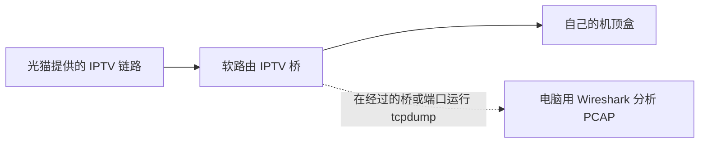
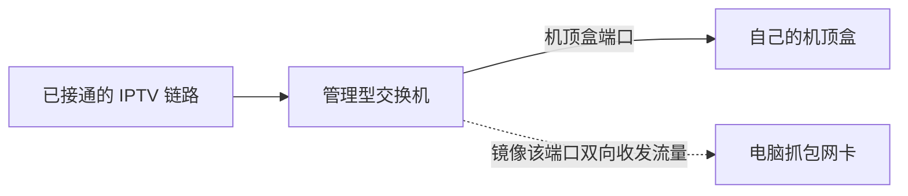

# 不知道 IPTV 账号？从这里开始

**先完成这一页，再填写 Compose。** 大多数人没有手工输入过 IPTV 账号：身份已经保存在电信机顶盒中，开机自动认证。宽带拨号账号、电信 App 手机号、机身 S/N 都不能直接当作 IPTV 协议身份。

本文只适用于自己的、已开通的上海电信 IPTV。先查机顶盒网络/业务信息页面，或联系运营商确认；拿不到完整字段时，再观察自己机顶盒的开机认证。不要抓取别人或公共网络的流量，不要将 PCAP 上传到在线解析网站。

## 最后需要拿到什么

| 要找的字段 | 填入 Compose | 常见混淆 |
| --- | --- | --- |
| 登录请求中的 `UserID` | `HOMECAST_USER_ID` | 不一定是宽带账号或手机号 |
| 同一登录请求中的 `SN` | `HOMECAST_PROTOCOL_SN` | 不一定是机身贴纸的物理 S/N |
| 同一机顶盒的业务 MAC | `HOMECAST_MAC` | 不是电脑、软路由或光猫的 MAC |
| 初始认证服务主机及端口 | `HOMECAST_AUTH_HOST` | 不是 HomeCast 或 udpxy 的 LAN 地址 |
| 部署主机实际 IPTV 接口名 | `HOMECAST_INTERFACE` | 来自本机网络配置，不是账号字段 |

准备：可正常播放的机顶盒、能观察它流量的抓包位置、该设备管理权限、抓包端的 tcpdump，以及电脑上的 Wireshark。Windows、macOS、Linux 均可用 Wireshark 分析文件。**仅安装 HomeCast 或 Wireshark，不会自动拿到账号。**

## 1. 确定抓包位置

推荐选择已有的一种条件：软路由上机顶盒实际经过的 IPTV 桥/物理接口；管理型交换机的端口镜像；专用网络 TAP。不必全部购买。



或者在交换机上观察：



机顶盒不必直插光猫，只需正确接入 IPTV。**在普通交换机旁边随便插一台电脑，通常看不到机顶盒的单播认证。** 端口镜像和 VLAN 分流是两回事，不要将镜像端口接回家庭网络形成环路。完整接线见 [网络准备](network.md)。

先确认机顶盒在这条链路上可播放，记录接线。不能播放时先解决网络或业务问题。软路由硬件交换/卸载可能让 CPU 抓包看不到经过的流量；不要随意关闭全家硬件加速或重启网络，优先选择明确的观察端口或镜像。

**完成标志：** 知道机顶盒接在哪个端口、应在哪个接口观察，以及实际使用的有线 MAC。贴纸可能有多个 MAC，要与机顶盒网络页面、交换机 MAC 表或 DHCP 记录核对。

## 2. 抓一次完整开机认证

下列命令在**抓包位置所在的 Linux 设备**执行，不是在任意 Wi-Fi 电脑上执行。用自己的接口和 MAC 替换示例；观察接口不一定等于最终的 `HOMECAST_INTERFACE`。

列出抓包接口：

```bash
tcpdump -D
```

先保持机顶盒关闭，开始抓包后再正常接通电源。目录仅管理员可读，按 MAC 过滤，保留完整包，同时限制时间和包数：

```bash
umask 077
mkdir -p /root/iptv-private
timeout 120 tcpdump -i YOUR_CAPTURE_INTERFACE -s 0 -U -c 10000 \
  -w /root/iptv-private/bootstrap.pcap 'ether host 02:00:00:00:00:01'
```

首页和正常直播出现后可提前按 `Ctrl+C`。超时退出不代表抓包失败，检查实际数据。不要等机顶盒已经登录后才开始，否则经常只剩视频包。

精简路由器若没有 `timeout`，用下面命令，**在首页出现或约 120 秒时手动按 Ctrl+C 停止**。包数上限不等于时间上限，不可无人值守：

```bash
tcpdump -i YOUR_CAPTURE_INTERFACE -s 0 -U -c 10000 \
  -w /root/iptv-private/bootstrap.pcap 'ether host 02:00:00:00:00:01'
```

不要改成 `-i any` 后照搬以太网 MAC 过滤，Linux cooked capture 的链路类型可能不同。镜像方案也可直接在电脑 Wireshark 中选接收镜像的有线网卡，设置捕获过滤器 `ether host 02:00:00:00:00:01`，按同样开机顺序抓取并及时停止。

**完成标志：** 文件不是空的，有机顶盒与运营商服务器的双向 TCP 会话，不只是 UDP 视频。没有包时先查接口、MAC 和镜像方向，不要反复重启碰运气。

## 3. 安全取回文件

在电脑通过自己的 SSH 登录方式取回 PCAP，不要放进 Web 服务器目录。替换 `ROUTER_LAN_IP`；若在其他设备抓包，就用该设备地址与账号。

macOS / Linux：

```bash
mkdir -p "$HOME/iptv-private"
chmod 700 "$HOME/iptv-private"
scp root@ROUTER_LAN_IP:/root/iptv-private/bootstrap.pcap "$HOME/iptv-private/"
```

Windows PowerShell（已安装 OpenSSH 客户端）：

```powershell
New-Item -ItemType Directory -Force "$HOME\iptv-private"
scp root@ROUTER_LAN_IP:/root/iptv-private/bootstrap.pcap "$HOME\iptv-private\bootstrap.pcap"
```

使用仅自己可访问、不共享或自动公开同步的目录。图形化 SFTP 下载也可以，不需要另开 HTTP 下载端口。

## 4. 在 Wireshark 找登录字段

1. 打开 PCAP，用显示过滤器 `eth.addr == 02:00:00:00:00:01`，换成自己的 MAC，确认设备正确。
2. 查 HTTP 请求：`http.request`。本项目已验证入口包含 `4kLogAuth.do`，可进一步用 `http.request.uri contains "4kLogAuth.do"`。
3. 选中请求，在包详情展开 **Hypertext Transfer Protocol**，查看完整 URI、查询参数和 `Host`。也可右键 **Follow / TCP Stream（追踪 TCP 流）**，选择 ASCII 或 UTF-8 查看重组请求。
4. 在同一登录请求中找 `UserID`、`SN`。参数可能经过 URL 编码，例如 `%40` 是 `@`；使用解码后的字段，不要把整条 URL 当账号。
5. 将请求来源与机顶盒业务/网络信息、以太网源 MAC 核对。若认证参数与有线 MAC 不一致，先查明固件的身份含义，不要猜值。

以下是**完全虚构、不能认证的示例**：

```http
GET /iptv3a/4kLogAuth.do?UserID=example%40etv2&Action=Login&SN=EXAMPLE1234 HTTP/1.1
Host: 192.0.2.2:7001
```

它对应 `HOMECAST_USER_ID="example@etv2"`、`HOMECAST_PROTOCOL_SN="EXAMPLE1234"`、`HOMECAST_AUTH_HOST="192.0.2.2:7001"`。**MAC 不在这段请求里，不能从 UserID 或 SN 推算**，必须另行核对。字段保留为字符串，尤其不要丢失 SN 前导零。

非标准端口若未识别成 HTTP，先确认内容确为明文 HTTP，再用 **Analyze / Decode As（分析 / 解码为）** 将对应 TCP 端口指定为 HTTP。请求分段时使用 TCP 流重组，不要只读一个包里的零散字节。

找不到 `4kLogAuth.do` 时，回到全部 `http.request`，在自己的开机流内容搜索 `UserID`、`SN`、`ottauth`。这些只是已验证协议的线索，不保证所有固件相同。**如果只有 TLS 加密流量而没有可读字段，抓到包不等于拿到账号。** 本教程不提供绕过 TLS、导出他人密钥或破解固件的方法；回到设备合法管理页面或运营商支持渠道，必要时说明固件暂不适配。

**完成标志：** 拿到同一设备、同一次成功认证链的 UserID、协议 SN、核对过的 MAC、初始认证地址，而不是临时 token。

## 5. 填入 Compose 并验证

填写**私有部署目录**里的 `compose.yaml` 的 `environment`，不要覆盖后提交公开仓库的示例。三个 LAN 服务地址、允许网段和 IPTV 接口见 [配置参考](configuration.md)，再回到 [快速开始](../README.md#快速开始) 拉取镜像。

不要把 `UserToken`、`JSESSIONID`、BIMS token、`encrytoken` 或抓到的 `authenticator` 当长期配置。HomeCast 使用自己的身份重新获取挑战并认证，不是每天重放旧抓包。`HOMECAST_PUBLIC_URL` 是播放器访问 HomeCast 的 LAN 地址，不是运营商认证地址。

验证：页面有最近成功更新时间、真实频道与节目单；两条 HTTP 订阅可读取；客户端能播放至少一个自己有权限的频道。列表存在不代表所有频道都有权限，视频问题还需查 [外部 udpxy](udpxy.md)。

再次刷新成功后确认无需重抓。程序会读取 IPTV 接口当前 IPv4，运营商分配的 IP 改变本身不要求重抓；更换机顶盒、账号或协议时才可能需要重新核对身份或调整适配。

## 卡住时检查什么

| 现象 | 先检查 |
| --- | --- |
| PCAP 没有包 | 观察点是否经过设备流量；接口、MAC、镜像源端口和方向 |
| 只有 UDP 视频，没有登录 | 是否晚于开机认证才抓；是否提前达到包数上限 |
| 有 TCP，HTTP 过滤却为空 | 非标准端口解码、流重组，或实际已使用 TLS |
| 有 UserID，没有 SN | 同一次开机的入口请求与完整流；不要用贴纸 S/N 硬凑 |
| 账号像是正确，认证仍失败 | IPTV IPv4、认证服务可达性、协议 SN、MAC、系统时间 |
| 有频道，但视频不播放 | 客户端到 udpxy 的可达性、组播接口与业务权限，通常无需重抓账号 |

求助时只提供设备型号、固件版本、观察位置、错误阶段和脱敏字段名。**不要在 issue、PR、截图或日志公开 PCAP、完整登录 URI、身份值、token 或 cookie。** 验证后删除不需要的临时抓包；确需保留时加密保存并限制访问。

## 工具参考

- [Wireshark：追踪与重组协议流](https://www.wireshark.org/docs/wsug_html_chunked/ChAdvFollowStreamSection.html)
- [Wireshark：HTTP 过滤器字段](https://www.wireshark.org/docs/dfref/h/http.html)
- [Wireshark：Decode As](https://www.wireshark.org/docs/wsug_html_chunked/ChAdvDecodeAs.html)
- [tcpdump 官方手册源码](https://github.com/the-tcpdump-group/tcpdump/blob/master/tcpdump.1.in)
