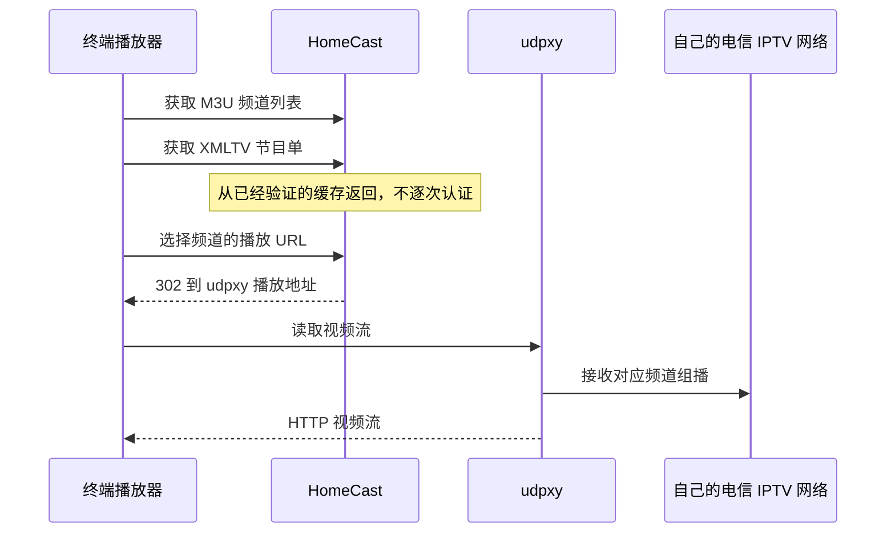

# 终端接入：M3U 与 XMLTV 怎么用

HomeCast 部署并完成首次刷新后，终端只需要订阅链接，**不需要填写电信账号、SN、MAC 或抓包信息**。这些身份仅保存在 HomeCast 的私有配置中。

## 两个链接，各管什么

以下 `192.0.2.1` 是文档示例地址，必须换成自己的 HomeCast LAN 地址。不要直接复制示例当作可播放源。

| 客户端里的字段 | 填入的链接示例 | 作用 |
| --- | --- | --- |
| M3U / Playlist URL / 频道列表 | `http://192.0.2.1:34400/m3u/xteve.m3u` | 频道名称、分组及每个频道的播放地址 |
| XMLTV / EPG URL / 节目单 | `http://192.0.2.1:34400/xmltv/xteve.xml` | 每个频道什么时候播什么节目 |

M3U 不是视频文件，XMLTV 也不能播放视频。只填 M3U 通常能看到频道、尝试直播；加上 XMLTV 才能显示节目表、当前及下一节目。节目单不意味着能回看，HomeCast 当前没有时移/回看功能。

优先填 **URL 订阅**，不要仅下载一次文件导入。文件导入是当时的快照，后续频道变化、节目单更新不会自动进入终端。HomeCast 的 M3U 头部会携带 EPG 地址，但不是所有客户端都会自动识别，所以仍应检查 XMLTV 字段。



因此终端必须同时能访问 HomeCast 和 udpxy。仅能打开管理页面，不代表视频链路一定畅通。

## Apple TV / 智能电视 / 手机 IPTV 播放器

使用支持 **远程 M3U + XMLTV** 的播放器。不同 App 菜单不一致，下面按字段说明，不假定所有 App 都支持相同功能：

1. 选择“添加播放列表 / 新增来源 / URL 订阅”，类型选择 M3U，不是 Xtream Codes、Stalker Portal 或账号密码登录。
2. 名称可填“家庭 IPTV”，频道 URL 填上面的 M3U 地址。
3. 在该来源的“EPG / 电视节目单 / XMLTV”设置中填 XMLTV 地址，并关联到同一播放列表。
4. 保存后执行一次“更新频道”和“更新节目单”，选一个自己已订阅的频道播放。
5. 打开客户端的定期更新或启动时更新。可将每日节目单更新时间放在 HomeCast 更新完成之后，例如 HomeCast 05:00、客户端 06:00。

这是第三方 IPTV 播放器的接入方式，不是把 URL 填进系统自带“Apple TV”影视订阅页面。若某 App 只支持 HLS，不支持 HTTP MPEG-TS 或 302 跳转，可能无法直接使用本服务；HomeCast 不会替它转码。

Apple 设备使用相关 App 时如出现本地网络访问请求，应允许访问家庭网络。设备须连接可访问服务器的家庭 LAN，访客 Wi-Fi、AP 隔离或 VPN 路由可能阻止访问。不要用 `localhost` 或 `127.0.0.1`，它们指向终端自己。

## Jellyfin

Jellyfin 原生直播页不按 M3U `group-title` 显示分组栏目。需要分组名称和排序时，使用这对专用链接：

```text
M3U:   http://192.0.2.1:34400/m3u/jellyfin.m3u
XMLTV: http://192.0.2.1:34400/xmltv/jellyfin.xml
```

它保留全部频道，名称显示为 `[央视] CCTV-1` 等，按央视、卫视、专题、地方与其他排序，并生成从1开始的连续频道编号；未知分组也保留在末尾。Jellyfin 中选择按频道编号排序即可连续浏览各组。这是名称和排序，不是新增可折叠分组控件。官方频道增减时连续编号可能调整，但 `tvg-id`、节目映射和视频地址保持不变。专用 XMLTV 同步使用带前缀的名称，避免名称来源不一致。原 `/m3u/xteve.m3u`、`/xmltv/xteve.xml` 的名称、编号和顺序不受影响，Apple TV 等现有客户端无需改订阅。

Jellyfin 的配置分两步，M3U 和 XMLTV 不能互相替代：

1. 管理控制台 → 直播电视 → 添加调谐器，选择 **M3U Tuner**。
2. “文件或 URL”填写 M3U 链接，保存。这里不是 HDHomeRun 自动发现。
3. 在电视节目单提供程序中添加 **XMLTV**，填写 XMLTV 链接，保存。
4. 执行一次节目单刷新，进入“直播电视 / 节目表”检查频道和节目。
5. 如个别频道未匹配，检查提供程序的频道映射。HomeCast 导出的 M3U `tvg-id` 和 XMLTV `channel id` 保持一致，不应分别随意改名或改 ID。

这些设置由 **Jellyfin 服务端** 拉取，因此要确认 Jellyfin 容器/主机也能访问上述地址及 udpxy，而不只是浏览器电脑能访问。保留原 xTeVe 地址迁移时通常不必重新添加调谐器，刷新现有源即可。具体菜单以安装版本为准。[Jellyfin 官方接入说明](https://jellyfin.org/docs/general/server/live-tv/setup-guide/)

## Kodi

在 Kodi 的 **IPTV Simple Client** 中配置一个来源，将 M3U 位置设为远程 URL，填写频道链接；在 EPG 设置中填写 XMLTV URL。保存并启用该来源后刷新频道/节目单，在电视菜单查看。不同 Kodi / 插件版本可能使用多配置实例。[IPTV Simple Client 官方说明](https://github.com/kodi-pvr/pvr.iptvsimple)

## VLC：先验证能不能播放

VLC 更适合快速确认播放链路。Windows / Linux 在“媒体 → 打开网络串流”中填 M3U URL，打开播放列表后选择频道；macOS 使用“文件 → 打开网络”的对应入口。这里不需要 XMLTV，也不能把 XMLTV 当成视频 URL。要完整的电视节目表体验，使用有 EPG 支持的 IPTV 客户端。[VideoLAN 官方网络串流说明](https://docs.videolan.me/vlc-user/desktop/3.0/en/basic/media.html)

## 更新是如何发生的

- HomeCast 每日按自己的计划获取官方数据，成功后原子替换缓存。手动“立即更新”也走同一流程。
- 终端按自己的计划重新读取 M3U / XMLTV。HomeCast 不会主动向所有终端推送更新。
- 看电视只读取缓存和视频流，不会每次启动就重新抓包或重新生成整个节目单。
- 官方接口异常时继续提供上次有效缓存；它不是永久有效的节目单，节目覆盖结束后仍需排查刷新错误。

## 常见问题

| 现象 | 优先检查 |
| --- | --- |
| 订阅失败 / 403 | 终端源 IP 是否在 `allowed_networks`；使用的域名是否在 `public_url` 或 `allowed_hosts` |
| 首次访问返回 503 | 是否已成功完成第一轮官方刷新；页面是否提示认证/网络失败 |
| 频道有了，节目单没有 | XMLTV 是否单独填写并关联；终端是否刷新；频道 ID 是否一致；缓存是否已过期 |
| 页面和节目单正常，直播黑屏 | udpxy 是否可达；其 IPTV 组播接口是否正确；该频道是否有订阅权限；终端是否支持流格式 |
| 电脑可用，电视不可用 | 不要使用电脑的 localhost；检查电视访客网隔离、本地网络权限、DNS和到 udpxy 的访问 |
| 迁移后还是旧列表 | 刷新客户端缓存；保留原服务地址；检查客户端是否导入了静态文件而不是 URL |
| 时间相差数小时 | 设备时区应正确，XMLTV 已包含 `+0800`；通常不应额外施加 EPG 时差 |
| 多台同时看卡顿 | 检查 udpxy 会话上限、网络/组播、线路并发限制；HomeCast 不增加运营商允许的并发数 |

不要为了排障把管理端口映射到公网。HTTP 视频地址是家庭内部服务，不是可分享的公共电视源。
