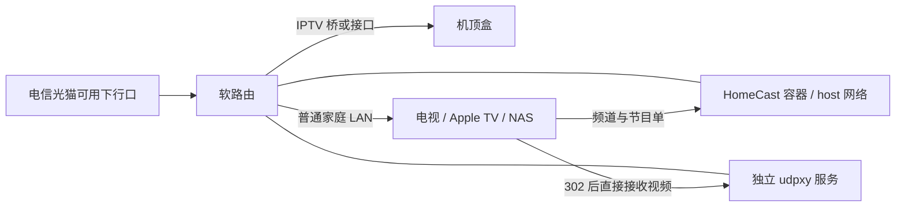
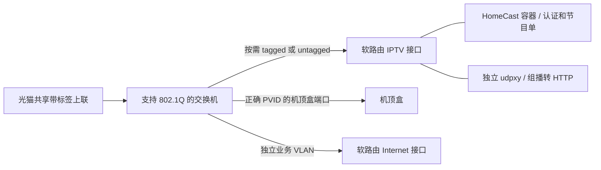

# 网络前置条件

**这一页属于部署前置条件，先于 Docker 安装。** HomeCast 只消费已经接通的上海电信 IPTV 网络，不配置光猫、VLAN、DHCP、路由或防火墙。先确认光猫实际交付的业务和标签，不应照抄其他家庭的网口、地址或路由。

## VLAN 51 和 85 都配置

本文采用上海电信常见的 **VLAN 51 + VLAN 85 双配置**，不需要先判断哪个负责组播、点播或认证。光猫到软路由、软路由到机顶盒的 IPTV 链路都保留这两个 VLAN；软路由通过专用 IPTV 桥接入这条业务网络。

前提是光猫下行确实交付对应的 tagged 业务。已去标签的专用 IPTV 口、已完成其他映射的现成网络不能机械套用；已有可用接口直接沿用。这里不是要求修改运营商配置，也不是所有上海线路永久统一的保证。光猫输出存在差异的历史实测见 [u128393（2019）](https://www.cnblogs.com/u128393/p/11629969.html)。

## 最简单的布置



条件：该下行口确实提供 IPTV；软路由已正确分离/承接 IPTV 业务，机顶盒能通过对应端口正常获取网络并播放。光猫不是普遍只有一个固定 IPTV 口：有的所有下行口都可用，有的只绑定部分端口。

## 什么时候需要管理型交换机



仅当需要在交换机上划分业务、添加/移除 VLAN 标签或设置 PVID 时使用这种结构。如果软路由能直接处理共享上联，就不必额外加交换机。

普通非管理交换机可以接在已能正常使用的 IPTV 口后面，再接机顶盒。它通常不会替你拆 VLAN，也没有端口镜像功能；某些设备不透明转发带标签帧，因此不能假定所有型号都适用。

## 软路由的 IPTV 桥怎么准备

以下以 OpenWrt / iStoreOS 的 LuCI 思路说明，界面名称随版本变化。**这是首次建网指南，不是对已有可用家庭网络执行的迁移脚本。** 已能认证和播放就沿用现有接口。变更前私下备份网络、DHCP、防火墙配置，保留本地管理口与恢复方式，在维护时间操作，不要远程盲目重启全家网络。

### 1. 先认清端口与光猫输出

记录哪个物理口连光猫、哪个口连机顶盒或 IPTV 交换机，确认该链路可承载 tagged 51/85。只使用实际确认的端口；`eth0`、`eth1`、`lan4` 等名字不是通用值。不要删除现有 Internet WAN，也不要把整个 WAN 和普通 `br-lan` 直接桥接。

机顶盒能在光猫口工作，但移到软路由后不工作，优先检查这一步。光猫管理权限拿不到时，可请装维确认业务绑定及输出方式，不需要修改光猫密码、刷机或猜测运营商侧 VLAN。

### 2. 两个 VLAN 子接口都建，再接入 IPTV 桥

下面是独立网卡的 x86 OpenWrt / iStoreOS 示例。假设 `eth0` 连光猫、`eth1` 连机顶盒链路，**先替换成自己的实际设备名**。DSA 或 swconfig 设备需按对应固件的交换机/桥 VLAN 页面配置，不能把这组名称原样照抄。

1. 在“网络 -> 接口 -> 设备”添加 802.1Q VLAN 设备：基于 `eth0` 分别创建 VLAN ID `51` 和 `85`，得到 `eth0.51`、`eth0.85`。
2. 对下联设备 `eth1` 同样创建 `eth1.51`、`eth1.85`。
3. 新增桥设备 `br-iptv`，成员选择上述四个 **VLAN 子接口**，不要选完整物理 WAN、普通 `br-lan` 或 Wi-Fi。

```text
光猫侧 eth0.51 ----+                 +---- eth1.51 机顶盒侧
                  +---- br-iptv ----+
光猫侧 eth0.85 ----+        |        +---- eth1.85 机顶盒侧
                           |
                   iptv（DHCP 客户端）
                           |
                   HomeCast + 外部 udpxy
```

这是将两条 IPTV 承载接入同一业务桥的兼容结构，**不是让 51 和 85 继续相互隔离**；若上下游已有另一条映射/桥接路径，不要再叠加形成二层环路。此合桥结构可参考 [王延炯（2022）的原文](https://yanjiong.wang/articles/shanghai-telecom-and-asuswrt-merlin-support-iptv)，但原文的梅林命令不能直接在 OpenWrt 执行。仅桥接给机顶盒还不够，本机 HomeCast/udpxy 需要下一步的 DHCP 接口。

经过管理型交换机时，创建 VLAN `51` 和 `85`，将连接软路由的上联口、通往机顶盒的下联/中继端口都加入两个 VLAN，按本方案保留 tagged。**上联口不能漏配。** 普通 LAN 的 untagged/PVID 保持原设计，不能把一个 PVID 当作同时配置两个 VLAN。机顶盒需要普通 LAN 的 A 面引导时也须保留该路径。交换机参考 [aRAY（2022）的原文及作者补充](https://aray.cn/14234)。如果终端实际要求 untagged，则先确认出口适配，不能套用 tagged 端口表。

### 3. 让软路由本机获得 IPTV 网络

在“网络 -> 接口”新增逻辑接口 `iptv`，协议选 **DHCP 客户端**，设备选上一步实际承接业务的设备，例如 `br-iptv`。不要在 IPTV 业务网启用家庭 DHCP **服务器**，也不要把家庭 LAN 地址手工填进去。

检查获取到的地址、网关与路由；不要硬编码别家的租约地址。IPTV 默认路由不能抢走正常 Internet 出口：按实际环境使用更低优先级的默认路由（更大的 metric），或经已确认的运营商网关配置所需的专用路由。**不能只取消默认路由而不补足到认证/EPG 服务的路由。** 不要让运营商 DNS 无意替换全家的 DNS 策略。对应 DHCP 与路由选项见 [OpenWrt LuCI 接口实现](https://github.com/openwrt/luci/blob/master/modules/luci-mod-network/htdocs/luci-static/resources/view/network/interfaces.js)；这不是要求修改源码。

### 4. 分清机顶盒引导与应用联网

部分上海电信机顶盒需要普通 LAN 的 DHCP Option 125 等引导，才能转入 IPTV 专网；这是原机顶盒的网络发现问题，不是 `HOMECAST_USER_ID` 的替代品。[aRAY 教程](https://aray.cn/14234) 有该场景的实例。不同设备、固件、光猫交付方式可能不同，参数应来自自己的线路，仅应用到需要的机顶盒范围，不要把旧文章十六进制串直接强加给全家所有客户端。

防火墙把 IPTV 与家庭管理网络分开，仅按实际需要允许 DHCP 应答、IGMP、直播组播及认证/EPG 回包。不要照搬旧教程的所有方向 ACCEPT，不需要把 HomeCast/udpxy 开放到 WAN。组播服务正常时也不要为了照教程再开启第二套 IGMP proxy；桥的 snooping、查询器和卸载须与实际拓扑配合，不能把全局开关当万能修复。

### 5. 最后接入 HomeCast 与 udpxy

先完成下面的验证，再将实际 IPTV 设备名填入 `HOMECAST_INTERFACE`，并独立配置 udpxy 的 `source`。逻辑接口名 `iptv` 与 Linux 设备名 `br-iptv` 不是同一回事；HomeCast 要的是后者。若单播和组播仍在不同设备上，必须先验证两条链路及 udpxy 的来源配置，不能只修改一个环境变量便认为问题解决。具体配置见 [外部 udpxy](udpxy.md)。

## 只读检查桥与接口

以下在软路由 SSH 中执行，macOS/Linux 终端和 Windows PowerShell 都可以用 SSH 进入。替换自己实际使用的接口名：

```sh
ip -d link show
ip -4 addr show dev br-iptv
ip -4 route show
ubus call network.interface.iptv status
bridge link show
bridge vlan show
```

没有 `bridge` 工具的旧固件可以用 `brctl show` 查看桥成员；`bridge vlan show` 展示的是桥 VLAN 过滤信息，不等于全部 802.1Q 子接口，后者需结合 `ip -d link show`。本节不要求提交配置或重启服务。输出含地址、MAC 等网络信息，对外分享前脱敏。

## 验证清单

1. 机顶盒在计划使用的链路上正常播放。
2. Linux IPTV 接口有运营商分配的 IPv4 地址；认证请求可经该接口发出。
3. 组播路由与链路可用，udpxy 的 `source` / `-m` 指向正确的 IPTV 接口。
4. HomeCast 的 `HOMECAST_INTERFACE` 是 IPTV 接口，`HOMECAST_BIND_ADDRESS` 是本机 LAN 监听 IPv4，不带协议或端口。
5. `HOMECAST_PUBLIC_URL` 是客户端使用的 HomeCast 统一地址，包含协议和端口；PUBLIC 不表示公网。
6. `HOMECAST_UDPXY_URL` 是独立 udpxy 的 HTTP 地址。播放器或 Jellyfin 服务端须能直接访问它，不能只验证 HomeCast 到 udpxy 的连通性。
7. HomeCast 的 `HOMECAST_ALLOWED_NETWORKS` 仅包含可信网段；HomeCast 和 udpxy 都没有 WAN 端口转发或公开反向代理。

容器使用 Linux host 网络，才能选择宿主机的 IPTV 接口；只增加 `NET_RAW` 能力供接口绑定使用，不需要 `privileged`、修改路由权限或挂载 Docker socket。这里推荐并验证的是 x86 Linux 软路由。其他具备同等网络条件的 Linux 主机理论上可行，但未验证；只有普通互联网接入的 NAS、PC、VPS 不具备条件。

HomeCast 和 udpxy 是两个独立部署单元：前者获取频道/EPG 并返回播放重定向，后者承接客户端的 HTTP 视频请求。更改 HomeCast 环境变量不会更改 udpxy 的监听或组播来源；HomeCast 的访问控制也不会保护 udpxy。设置方式见 [外部 udpxy](udpxy.md)，三个地址的区别见 [配置指南](configuration.md#三个地址)。

抓包需要实际观察机顶盒流量：桥上的 tcpdump、支持镜像的管理型交换机，或者专用网络 TAP。把普通电脑插在普通交换机旁边，并不会自动收到机顶盒的单播认证流量。详见 [账号发现](account-discovery.md)。

## 原文参考与适用边界

- [u128393：上海电信 TL-EP110 + RT-AC86U 实现观看 4K IPTV 无卡顿（2019-10-07）](https://www.cnblogs.com/u128393/p/11629969.html)：51/85 与更换光猫后的组播观察差异，含作者的映射推断和验证。
- [aRAY：上海电信改桥接 IPTV 设置小白教程（2022-05-15）](https://aray.cn/14234)：OpenWrt 双 VLAN 透传、机顶盒引导与管理型交换机。作者在评论中补充了交换机上联口也须加入相应 VLAN。
- [王延炯：上海电信桥接拨号与 ASUS AiMesh 支持 IPTV 机顶盒（2022-04-02）](https://yanjiong.wang/articles/shanghai-telecom-and-asuswrt-merlin-support-iptv)：另一种历史合桥实例，设备及命令平台不同。

以上为作者自己的实践记录，不是电信官方规范；本文引用其经验并标明边界，不复制其完整文章、图片或部署脚本。网络已经可用时，不需要照文章重新配置。
