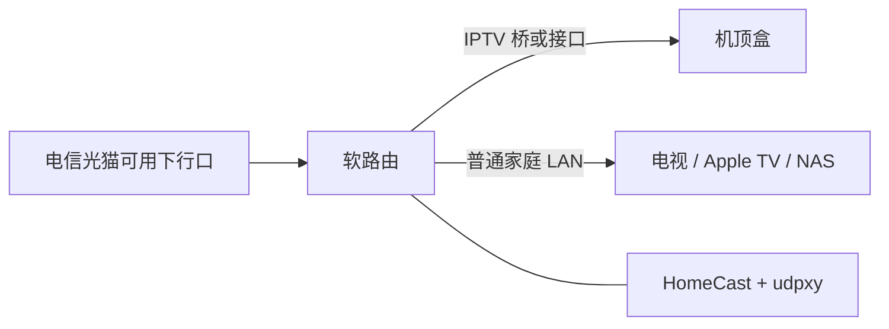
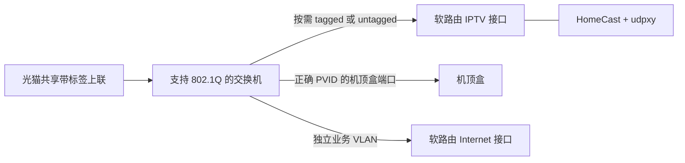

# 网络前置条件

HomeCast 只消费已经接通的上海电信 IPTV 网络，不配置光猫、VLAN、DHCP、路由或防火墙。VLAN ID、认证入口、端口绑定因地区/配置不同，不应照抄其他家庭的数值。

## 最简单的布置

条件：该下行口确实提供 IPTV；软路由已正确分离/承接 IPTV 业务，机顶盒能通过对应端口正常获取网络并播放。光猫不是普遍只有一个固定 IPTV 口：有的所有下行口都可用，有的只绑定部分端口。

## 什么时候需要管理型交换机

仅当需要在交换机上划分业务、添加/移除 VLAN 标签或设置 PVID 时使用这种结构。如果软路由能直接处理共享上联，就不必额外加交换机。

普通非管理交换机可以接在已能正常使用的 IPTV 口后面，再接机顶盒。它通常不会替你拆 VLAN，也没有端口镜像功能；某些设备不透明转发带标签帧，因此不能假定所有型号都适用。

## 验证清单

1. 机顶盒在计划使用的链路上正常播放。
2. Linux IPTV 接口有运营商分配的 IPv4 地址；认证请求可经该接口发出。
3. udpxy 绑定正确的组播接口，并且 LAN 播放器能访问它。
4. HomeCast 的 `interface` 是 IPTV 接口，`bind_address` 是 LAN 地址。
5. 没有为管理页面添加 WAN 端口转发或公开反向代理。

容器使用 Linux host 网络，才能选择宿主机的 IPTV 接口；只增加 `NET_RAW` 能力供接口绑定使用，不需要 `privileged`、修改路由权限或挂载 Docker socket。这里验证的是 x86 Linux 软路由，其他 Linux/NAS 方案需要等价网络条件并自行验证。

抓包需要实际观察机顶盒流量：桥上的 tcpdump、支持镜像的管理型交换机，或者专用网络 TAP。把普通电脑插在普通交换机旁边，并不会自动收到机顶盒的单播认证流量。详见 [账号发现](account-discovery.md)。
