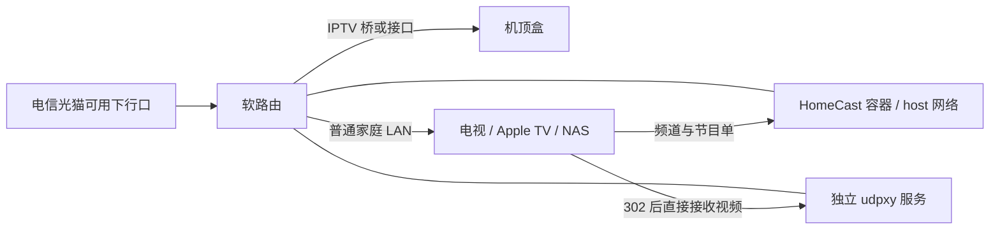
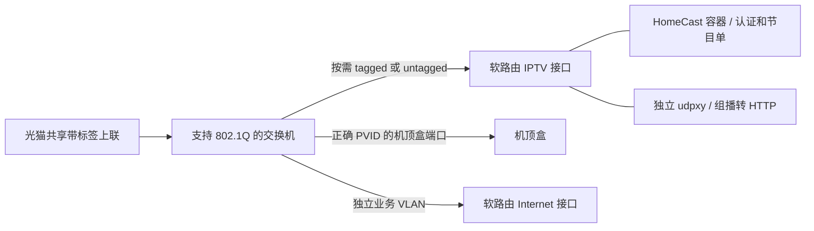

# 网络前置条件

HomeCast 只消费已经接通的上海电信 IPTV 网络，不配置光猫、VLAN、DHCP、路由或防火墙。VLAN ID、认证入口、端口绑定因地区/配置不同，不应照抄其他家庭的数值。

## 最简单的布置

条件：该下行口确实提供 IPTV；软路由已正确分离/承接 IPTV 业务，机顶盒能通过对应端口正常获取网络并播放。光猫不是普遍只有一个固定 IPTV 口：有的所有下行口都可用，有的只绑定部分端口。

## 什么时候需要管理型交换机

仅当需要在交换机上划分业务、添加/移除 VLAN 标签或设置 PVID 时使用这种结构。如果软路由能直接处理共享上联，就不必额外加交换机。

普通非管理交换机可以接在已能正常使用的 IPTV 口后面，再接机顶盒。它通常不会替你拆 VLAN，也没有端口镜像功能；某些设备不透明转发带标签帧，因此不能假定所有型号都适用。

## 验证清单

1. 机顶盒在计划使用的链路上正常播放。
2. Linux IPTV 接口有运营商分配的 IPv4 地址；认证请求可经该接口发出。
3. 组播路由与链路可用，udpxy 的 `source` / `-m` 指向正确的 IPTV 接口。
4. HomeCast 的 `HOMECAST_INTERFACE` 是 IPTV 接口，`HOMECAST_BIND_ADDRESS` 是本机 LAN 监听 IPv4，不带协议或端口。
5. `HOMECAST_PUBLIC_URL` 是客户端使用的 HomeCast 统一地址，包含协议和端口；PUBLIC 不表示公网。
6. `HOMECAST_UDPXY_URL` 是独立 udpxy 的 HTTP 地址。播放器或 Jellyfin 服务端须能直接访问它，不能只验证 HomeCast 到 udpxy 的连通性。
7. HomeCast 的 `HOMECAST_ALLOWED_NETWORKS` 仅包含可信网段；HomeCast 和 udpxy 都没有 WAN 端口转发或公开反向代理。

容器使用 Linux host 网络，才能选择宿主机的 IPTV 接口；只增加 `NET_RAW` 能力供接口绑定使用，不需要 `privileged`、修改路由权限或挂载 Docker socket。这里推荐并验证的是 x86 Linux 软路由。其他具备同等网络条件的 Linux 主机理论上可行，但未验证；只有普通互联网接入的 NAS、PC、VPS 不具备条件。

HomeCast 和 udpxy 是两个独立部署单元：前者获取频道/EPG 并返回播放重定向，后者承接客户端的 HTTP 视频请求。更改 HomeCast 环境变量不会更改 udpxy 的监听或组播来源；HomeCast 的访问控制也不会保护 udpxy。设置方式见 [外部 udpxy](udpxy.md)，三个地址的区别见 [配置指南](configuration.md#三个地址)。

抓包需要实际观察机顶盒流量：桥上的 tcpdump、支持镜像的管理型交换机，或者专用网络 TAP。把普通电脑插在普通交换机旁边，并不会自动收到机顶盒的单播认证流量。详见 [账号发现](account-discovery.md)。
